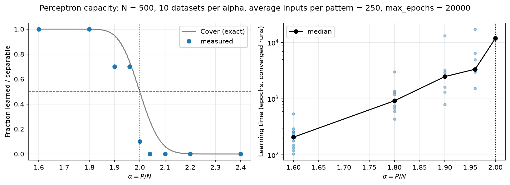
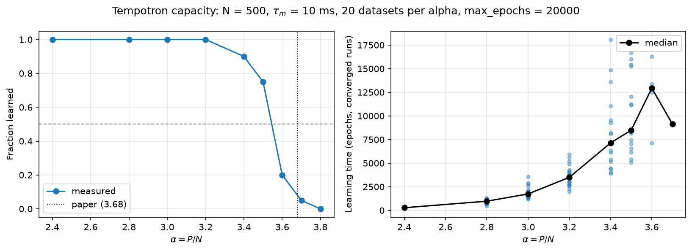
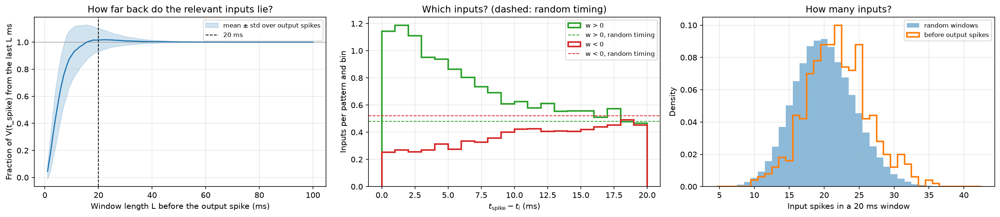
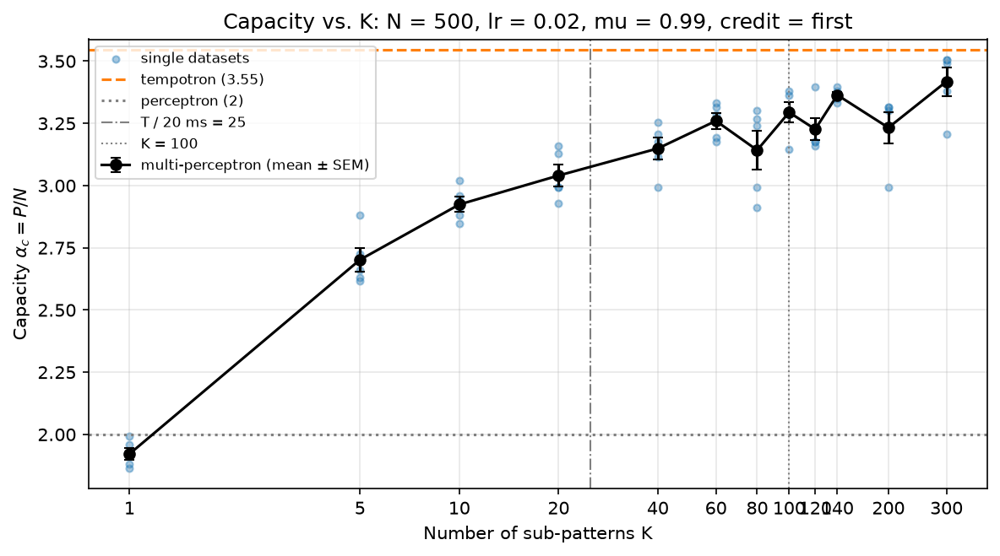
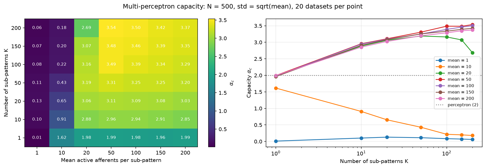

# Tempotron capacity

Numerical study of the classification capacity $\alpha_c = P/N$ of three single-neuron models trained on random patterns:

1. **Perceptron:** reference model whose capacity is known exactly ($\alpha_c = 2$, Cover 1965).
2. **Tempotron** (Gütig & Sompolinsky 2006): a leaky integrate-and-fire neuron that learns to classify spatiotemporal spike patterns.
3. **Multi-perceptron:** a discrete model of the tempotron's decision. It is a perceptron with an OR rule over $K$ binary sub-patterns ("time windows").

The tempotron is simulated by **exact event-based integration**. The membrane potential is evaluated analytically between input spikes, with no time grid. Its maximum and the first threshold crossing are therefore exact, including shunting after the first output spike.

## Results

| Model | Measured capacity | Reference |
|---|---|---|
| Perceptron ($N = 500$) | $\alpha_c \approx 1.97$ | 2 (Cover 1965) |
| Tempotron ($N = 500$, $T = 500$ ms, $\tau_m = 10$ ms) | $> 3.5$ (75 % of datasets learned at $\alpha = 3.5$) | ≈ 3.68 (Rubin et al. 2010) |
| Multi-perceptron, $K = 1 / 10 / 100 / 300$ | $1.92 / 2.92 / 3.29 / 3.42$ | — |

**Perceptron.** The measured fraction of learnable datasets follows Cover's separability curve. This validates the capacity measurement.



**Tempotron.** All datasets are learned up to $\alpha = 3.2$, and 75 % at $\alpha = 3.5$, at $\alpha = 3.8$ no more datasets are learned, consistent with the predicted capacity $\alpha_c \approx 3.68$ (Rubin et al. 2010). Learning is fast over a broad plateau of parameters: $\tau_m$ between 7.5 and 25 ms, and initial learning rates between 0.5× and 4× the value of Gütig & Sompolinsky (2006).



**What makes the tempotron fire?** The potential at an output spike is almost entirely due to the inputs in the preceding 20 ms. These windows contain 21.9 ± 4.5 input spikes, compared with 20.0 ± 4.4 in random windows. Firing is therefore driven mainly by *which* afferents are active in a short window, not by how many. This motivates the multi-perceptron.



**Multi-perceptron.** Each pattern is a set of $K$ binary sub-patterns, with window statistics taken from the trained tempotron. Capacity rises steeply from the perceptron value at $K = 1$, then grows slowly. It approaches the tempotron's capacity but stays below it up to $K = 300$.



**Multi-perceptron on a grid of $K$ and input sparsity.** Capacity as a function of the number of sub-patterns and of the mean number of active afferents per sub-pattern.



## Repository structure

```
├── Summary.ipynb            # main notebook: models, experiments, results and figures (computes nothing)
├── models/                  # the models: data, forward pass, learning rule, training
│   ├── perceptron.py        #   classic perceptron (reference model)
│   ├── tempotron.py         #   tempotron with exact event-based integration
│   └── multi_perceptron.py  #   perceptron with OR rule over K sub-patterns
├── experiments/             # one script per experiment, parameters at the top
│   ├── runner.py            #   result file names, saving/loading, resumable parallel scans
│   ├── perceptron_single.py, perceptron_capacity.py
│   ├── tempotron_single.py  #   single run + analysis of the inputs before output spikes
│   ├── tempotron_tau_scan.py, tempotron_lr_scan.py, tempotron_capacity.py
│   ├── mpc_single.py, mpc_tune.py, mpc_capacity_vs_K.py
│   ├── mpc_grid_scan.py     #   capacity on a grid of K and input sparsity
│   └── mpc_data_scan.py     #   "exactly once" vs. independent sub-patterns
├── cluster/                 # SLURM job script for the grid scan
├── results/                 # results (CSV/NPZ/JSON), written by the experiments, read by the notebook
└── figures/                 # figures saved by the notebook
```

**Design.** The model code exists once, in `models/`, together with the standard parameters of each model. Every experiment is one script in `experiments/` with its own parameters at the top. Result file names are built from these parameters (`runner.make_name`), so a changed parameter writes a new file and old results are never mixed in. Scans are resumable: an interrupted run continues where it stopped. `Summary.ipynb` only loads the results; if one is missing, it prints the command that computes it.

## Installation

```bash
conda env create -f environment.yml
conda activate tempotron
```

## Usage

All commands are run from the project folder. Every experiment is started as a module:

```bash
python -m experiments.perceptron_capacity --n-jobs 7
python -m experiments.tempotron_capacity --n-jobs 7
python -m experiments.mpc_data_scan --n-jobs 7
```

`--n-jobs` sets the number of parallel processes (default: all cores but one). Results already in `results/` are skipped, so a scan can be stopped and restarted at any time. For long runs on macOS, prefix the command with `caffeinate -i` to keep the machine awake, and save the output with `2>&1 | tee logs/<name>.log`.

Then open `Summary.ipynb` and run all cells.

**Cluster.** The scans run unchanged on a SLURM cluster: copy the project folder (or clone the repository) and submit one job per parameter combination, each with its own `--tag`, e.g. `cluster/grid.sbatch` for the grid scan. Afterwards, merge the part files into one result file:

```bash
python -m experiments.mpc_grid_scan --merge
```

## References

- T. M. Cover, "Geometrical and statistical properties of systems of linear inequalities with applications in pattern recognition", *IEEE Trans. Electron. Comput.* EC-14, 326–334 (1965).
- R. Gütig and H. Sompolinsky, "The tempotron: a neuron that learns spike timing-based decisions", *Nat. Neurosci.* 9, 420–428 (2006).
- R. Rubin, R. Monasson and H. Sompolinsky, "Theory of spike timing-based neural classifiers", *Phys. Rev. Lett.* 105, 218102 (2010).
