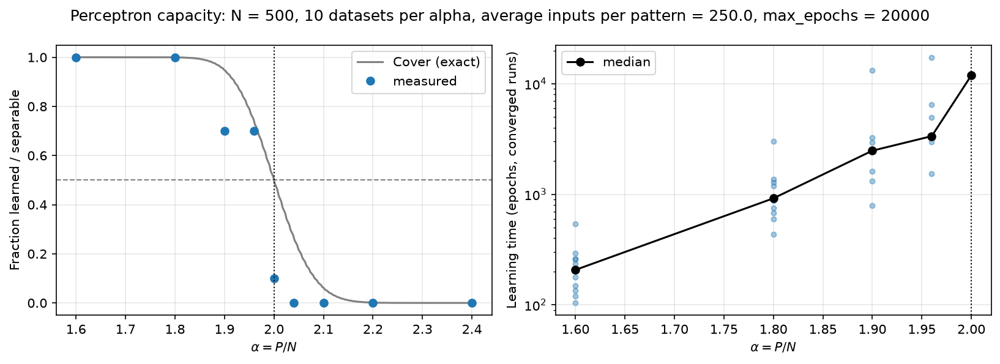
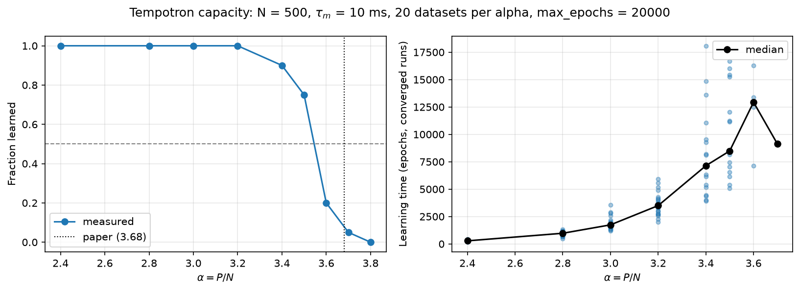
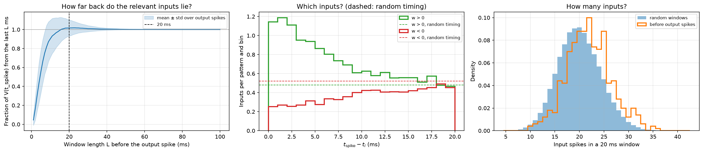
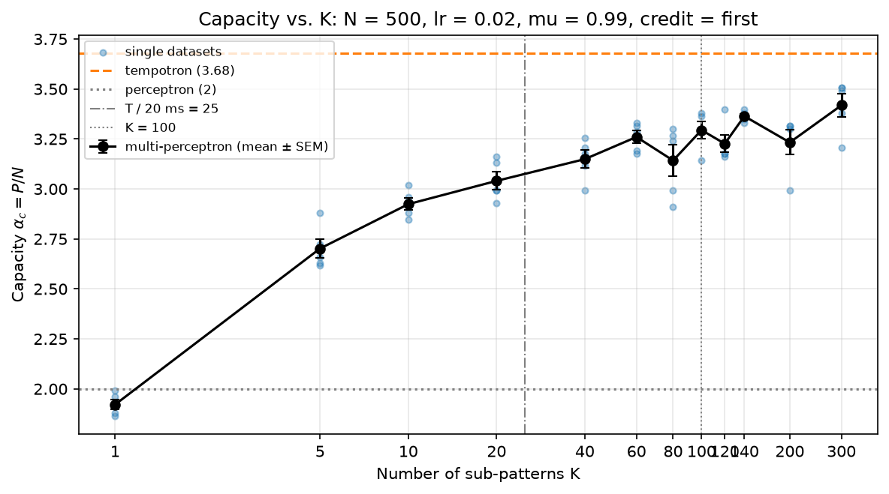

# Tempotron capacity

Numerical study of the classification capacity $\alpha_c = P/N$ of three single-neuron models trained on random patterns:

1. **Perceptron:** reference model whose capacity is known exactly ($\alpha_c = 2$, Cover 1965).
2. **Tempotron** (Gütig & Sompolinsky 2006): a leaky integrate-and-fire neuron that learns to classify spatiotemporal spike patterns.
3. **Multi-perceptron:** a discrete model of the tempotron's decision. It is a perceptron with an OR rule over $K$ binary sub-patterns ("time windows").

The tempotron is simulated by **exact event-based integration**. The membrane potential is evaluated analytically between input spikes, with no time grid. Its maximum and the first threshold crossing are therefore exact, including shunting after the first output spike.

## Results

| Model | Measured capacity | Reference |
|---|---|---|
| Perceptron ($N = 500$) | $\alpha_c \approx 1.97$ | 2 (Cover 1965) |
| Tempotron ($N = 500$, $T = 500$ ms, $\tau_m = 10$ ms) | $> 3.5$ (75 % of datasets learned at $\alpha = 3.5$) | ≈ 3.68 (Rubin et al. 2010) |
| Multi-perceptron, $K = 1 / 10 / 100 / 300$ | $1.92 / 2.92 / 3.29 / 3.42$ | — |

**Perceptron.** The measured fraction of learnable datasets follows Cover's separability curve. This validates the capacity measurement.



**Tempotron.** All datasets are learned up to $\alpha = 3.2$, and 75 % at $\alpha = 3.5$, at $\alpha = 3.8$ no more datasets are learned, consistent with the predicted capacity $\alpha_c \approx 3.68$ (Rubin et al. 2010). Learning is fast over a broad plateau of parameters: $\tau_m$ between 7.5 and 25 ms, and initial learning rates between 0.5× and 4× the value of Gütig & Sompolinsky (2006).



**What makes the tempotron fire?** The potential at an output spike is almost entirely due to the inputs in the preceding 20 ms. These windows contain 21.9 ± 4.5 input spikes, compared with 20.0 ± 4.4 in random windows. Firing is therefore driven mainly by *which* afferents are active in a short window, not by how many. This motivates the multi-perceptron.



**Multi-perceptron.** Each pattern is a set of $K$ binary sub-patterns, with window statistics taken from the trained tempotron. Capacity rises steeply from the perceptron value at $K = 1$, then grows slowly. It approaches the tempotron's capacity but stays below it up to $K = 300$.



## Repository structure

```
├── Summary.ipynb                     # main notebook: models, experiments, figures
├── tempotron.py                      # tempotron: data, kernel, exact integration, learning rules
├── perceptron.py                     # classic perceptron (reference model)
├── multi_perceptron.py               # perceptron with OR rule over K sub-patterns
├── experiments.py                    # result file names, caching, resumable and parallel scans
├── config.py                         # shared parameters for notebook and scripts
├── run_capacity_tempotron.py         # long capacity scan from the terminal (multi-core)
├── run_capacity_multi_perceptron.py  # capacity vs. K scan from the terminal (multi-core)
├── results/                          # cached results (CSV/JSON/NPZ), read by the notebook
└── figures/                          # figures saved by the notebook
```

**Design.** All parameters live in `config.py`. Result file names are built from these parameters (`experiments.make_name`), so a changed parameter writes a new file and old results are never mixed in. Scans are resumable: an interrupted run continues where it stopped. The notebook and the terminal scripts read and write the same files.

## Installation

```bash
conda env create -f environment.yml
conda activate tempotron
```

## Usage

Open `Summary.ipynb` and run all cells. Results already in `results/` are loaded, not recomputed.

The long scans are meant to run from the terminal and use all CPU cores but one:

```bash
mkdir -p logs
python -u run_capacity_tempotron.py 2>&1 | tee logs/capacity_tempotron.log
python -u run_capacity_multi_perceptron.py 2>&1 | tee logs/capacity_multi_perceptron.log
```

On macOS, prefix the commands with `caffeinate -i` to keep the machine awake.

## References

- T. M. Cover, "Geometrical and statistical properties of systems of linear inequalities with applications in pattern recognition", *IEEE Trans. Electron. Comput.* EC-14, 326–334 (1965).
- R. Gütig and H. Sompolinsky, "The tempotron: a neuron that learns spike timing-based decisions", *Nat. Neurosci.* 9, 420–428 (2006).
- R. Rubin, R. Monasson and H. Sompolinsky, "Theory of spike timing-based neural classifiers", *Phys. Rev. Lett.* 105, 218102 (2010).
